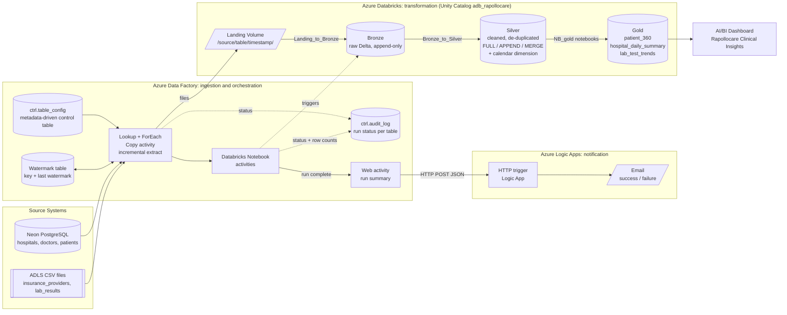
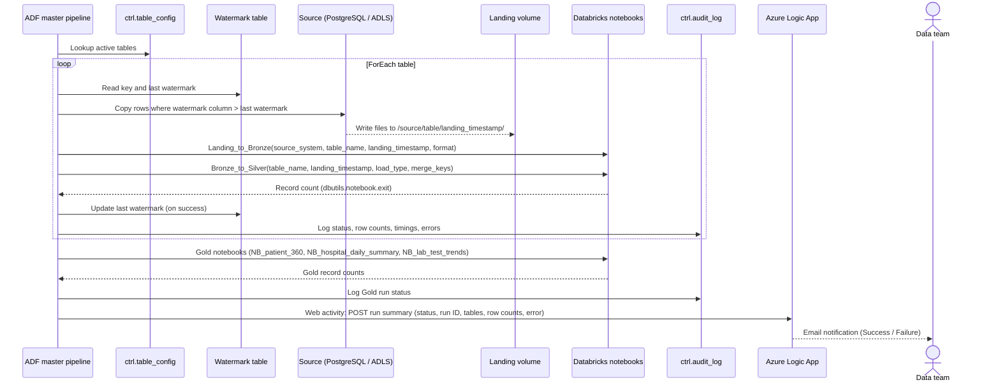
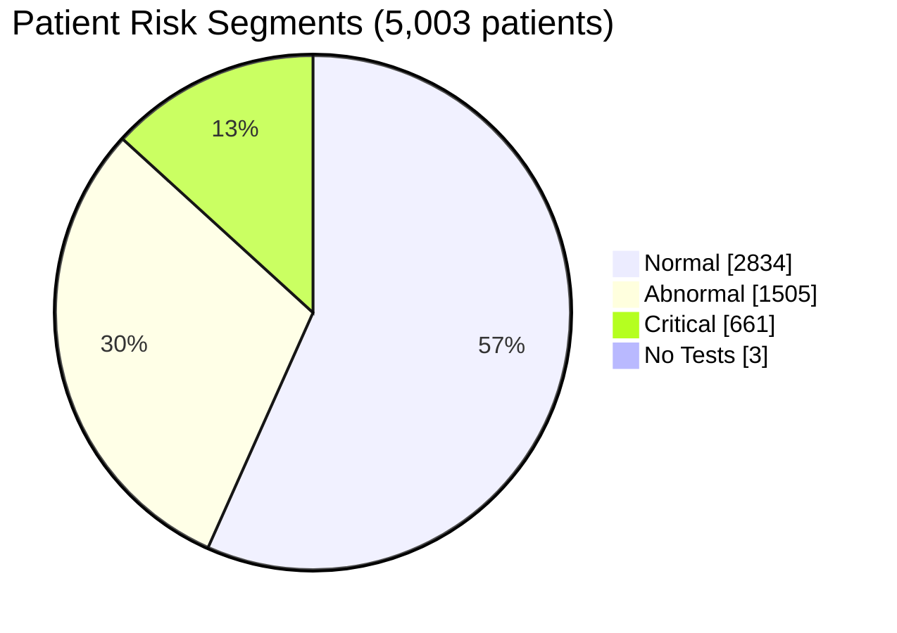
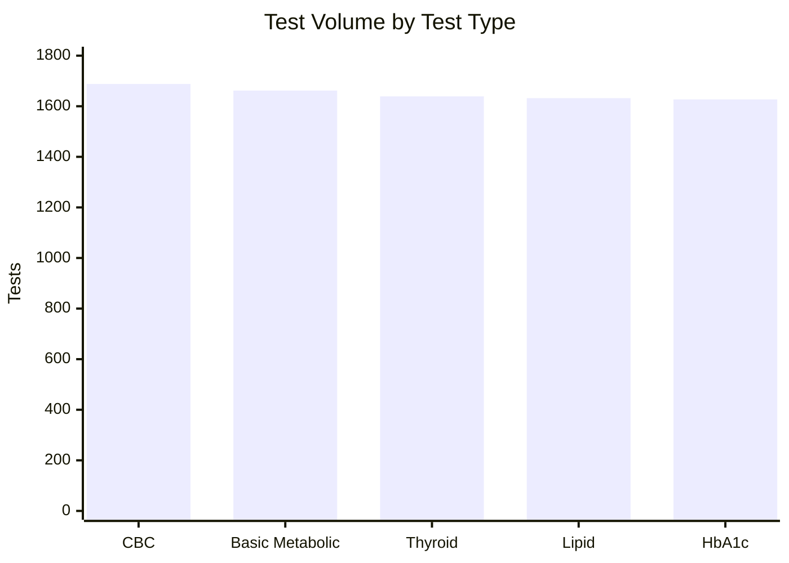
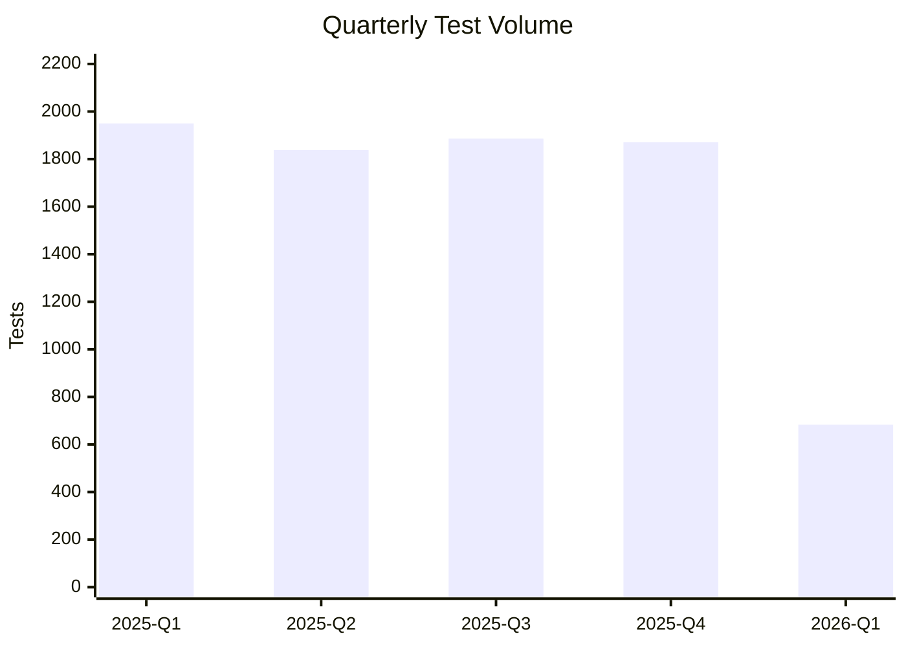

# RapolloCare Hospital Network (ADF + Azure Databricks + Lakehouse)

An end-to-end, **metadata-driven ELT pipeline** using **Azure Data Factory (ADF)** for ingestion and orchestration and **Azure Databricks** for transformation. It consolidates hospital, doctor, patient, insurance and lab-test data from multiple source systems into a governed **Medallion Lakehouse (Landing -> Bronze -> Silver -> Gold)** on **Unity Catalog** and **Delta Lake**, producing analytics-ready Gold tables and an AI/BI dashboard for patient, hospital-operations and clinical-quality reporting.

---

## Table of Contents

1. [Business Problem](#business-problem)
2. [Solution Overview](#solution-overview)
3. [Architecture](#architecture)
4. [Ingestion and Orchestration (Azure Data Factory)](#ingestion-and-orchestration-azure-data-factory)
5. [Data Sources](#data-sources)
6. [Medallion Layers](#medallion-layers)
7. [Gold Data Products](#gold-data-products)
8. [Dashboard: Rapollocare Clinical Insights](#dashboard-rapollocare-clinical-insights)
9. [Tech Stack and Skills](#tech-stack-and-skills)
10. [Key Engineering Features](#key-engineering-features)
11. [Repository Structure](#repository-structure)
12. [How to Run](#how-to-run)
13. [Business Problems and Solutions](#business-problems-and-solutions)
14. [Future Enhancements](#future-enhancements)

---

## Business Problem

RapolloCare is a multi-hospital healthcare network. Its operational data is spread across separate systems:

* Master data (hospitals, doctors, patients) lives in an operational **PostgreSQL** database.
* Partner and diagnostic data (insurance providers, lab results) arrives as **CSV files** in cloud storage.

This fragmentation caused:

* No single, trusted view of a patient across hospitals, insurers and lab tests.
* Duplicate and out-of-date master records because the same entity is re-sent on every extract.
* Full re-extracts and manual, per-table loads that were slow and hard to scale.
* Slow, manual reporting on hospital workload and lab-test outcomes.
* No easy way to spot rising abnormal or critical test rates over time.
* No lineage or audit trail showing when a record arrived or was last changed.

## Solution Overview

A metadata-driven ELT framework in which **ADF ingests and orchestrates** and **Databricks transforms**:

* **Configures** every source table once in the control table `ctrl.table_config` (source, target, load type, keys, active flag).
* **Extracts** data with ADF, using a **watermark table** that holds each table's key and last watermark value so only new or changed rows are pulled (incremental load).
* **Lands** the extracts as files in a Unity Catalog **landing volume**, partitioned by source system, table and load timestamp.
* **Orchestrates** the Databricks notebooks from ADF, passing parameters per table, and **logs every run** (status, row counts, timings, errors) to `ctrl.audit_log`.
* **Notifies** the team by **email after every run** (success or failure) through an **Azure Logic App** called from ADF.
* **Loads** each batch as-is into **Bronze** Delta tables with audit columns (raw history).
* **Transforms** Bronze into clean, de-duplicated **Silver** tables using configurable `FULL`, `APPEND` or `MERGE` (upsert) loads.
* **Models** business-ready **Gold** tables (Patient 360, Hospital Daily Summary, Lab Test Trends) driven by a Source-to-Target Mapping (STTM) document.
* **Serves** the Gold layer through the **Rapollocare Clinical Insights** AI/BI dashboard.
* Uses one reusable ADF pipeline and one reusable notebook per layer, so new tables are onboarded by adding a row to the control table instead of writing new code.

---

## Architecture



Text version:

```
                 ctrl.table_config   watermark table          ctrl.audit_log
                         |                 ^ |                      ^
                         v                 | v                      |
 Neon PostgreSQL --+   +---------------------------------+          |
                   +-->|  Azure Data Factory             |----------+
 ADLS CSV files ---+   |  Lookup -> ForEach -> Copy      |
                       |  -> Databricks Notebook tasks   |
                       +---------------------------------+
                                   |
                                   v
          Landing Volume --> Bronze --> Silver --> Gold --> AI/BI Dashboard
           (UC Volume)       (raw)      (clean)    (business)
          |<--------------- Azure Databricks ------------->|

  End of every ADF run --> Web activity --> Azure Logic App --> Email (Success / Failure)
```

**Design principles**

* **Separation of concerns**: ADF handles ingestion, control and orchestration; Databricks handles all transformation and serving.
* **Metadata-driven**: pipeline behaviour comes from `ctrl.table_config`, not from hard-coded pipelines.
* **Incremental by default**: the watermark table drives delta extraction from the sources.
* **Observable**: every run is written to `ctrl.audit_log`, and the team gets an email after every run through Azure Logic Apps.
* **Medallion architecture** separating raw, cleansed and business-level data.
* **Unity Catalog** catalog `adb_rapollocare` with schemas `landing`, `bronze`, `silver`, `gold` for governance and lineage.
* **Delta Lake** for ACID writes, MERGE upserts and time travel.
* **Parameter-driven notebooks** so a single notebook serves every table in a layer.
* **Batch isolation** by `landing_timestamp`: each run processes exactly one landed batch, which makes runs idempotent and easy to re-run.

---

## Ingestion and Orchestration (Azure Data Factory)

ADF ingests data from the source systems into the landing volume and orchestrates the Databricks notebooks end to end. The pipeline is generic and driven by three control tables.

### Control tables

| Table | Purpose | Typical contents |
| --- | --- | --- |
| `ctrl.table_config` | Metadata-driven control table: one row per source table to ingest | Source system, source table or file path, target table name, file format, load type (`FULL` / `APPEND` / `MERGE`), merge keys, active flag |
| Watermark table | Incremental-load control | Key / watermark column per table and the **last watermark value** loaded successfully |
| `ctrl.audit_log` | Run logging and monitoring | Pipeline run ID, table name, layer, status (Succeeded / Failed), rows read / written, start and end time, error message |

### Pipeline flow



### Steps

1. **Lookup** reads the active rows from `ctrl.table_config`.
2. **ForEach** loops over the tables, in parallel where possible.
3. **Watermark lookup** gets the table's key and last watermark value.
4. **Copy activity** extracts only new or changed rows (incremental) and writes them to the landing volume under `<source_system>/<table_name>/<landing_timestamp>/`.
5. **Databricks Notebook activities** run `Landing_to_Bronze` and then `Bronze_to_Silver` with parameters taken from `ctrl.table_config`.
6. **Watermark update** saves the new maximum watermark only after a successful load, so a failed run is picked up again next time.
7. **Audit logging** writes the status, row counts (returned by each notebook through `dbutils.notebook.exit`), timings and any error to `ctrl.audit_log`.
8. **Gold refresh** runs the Gold notebooks once all Silver loads have finished; the dashboard reads the refreshed Gold tables.
9. **Email notification** runs at the end of every pipeline run: a Web activity calls the Azure Logic App, which emails the run result to the team.

### Email Notifications (Azure Logic Apps)

After each pipeline run, ADF sends the run result to an **Azure Logic App**, which emails the data team. Both success and failure are reported, so nobody has to watch the ADF monitor or query the audit log.

**How it works**

1. The Logic App has an **HTTP request trigger** ("When an HTTP request is received") with a JSON schema for the run summary.
2. At the end of the ADF master pipeline, a **Web activity** sends an HTTP POST to the Logic App URL. It is connected on both the **Success** and **Failure** paths, so an email goes out for every run.
3. The Logic App parses the payload, picks the subject and body based on status, and **sends the email** with its email connector (for example Office 365 Outlook).

**Example payload sent by ADF**

```json
{
  "pipelineName": "@{pipeline().Pipeline}",
  "runId": "@{pipeline().RunId}",
  "status": "Succeeded",
  "triggerTime": "@{pipeline().TriggerTime}",
  "dataFactory": "@{pipeline().DataFactory}",
  "tablesProcessed": 5,
  "rowsLoaded": 1250,
  "errorMessage": ""
}
```

**Email content**

| Field | Example |
| --- | --- |
| Subject | `[RapolloCare ELT] Succeeded - PL_Master_Ingestion - 2026-11-19 06:00` or `[RapolloCare ELT] FAILED - ...` |
| Body | Pipeline name, run ID, status, start time and duration, tables processed, rows loaded, error message (on failure), link to the ADF run monitor |
| Recipients | Data engineering and support distribution list |

**Benefits**

* The team learns about failures straight away instead of discovering missing data later.
* Success emails confirm that the dashboard data has been refreshed.
* The alerting logic sits in a Logic App, outside the pipeline, so recipients and templates can change without editing ADF.

---

## Data Sources

| Source system | Ingested by | Landing folder | Landing format | Entities | Description |
| --- | --- | --- | --- | --- | --- |
| Neon PostgreSQL (operational DB) | ADF Copy (incremental by watermark) | `neon_postgres/` | Parquet | `hospitals`, `doctors`, `patients` | Master data: hospital network, doctors and registered patients |
| Azure Data Lake Storage (file drops) | ADF Copy | `adls_csv/` | CSV (header) | `insurance_providers`, `lab_results` | Insurance partner reference data and lab test results |
| Generated in Databricks | Databricks notebook | n/a | Delta | `calendar` | Date dimension 1940-01-01 to 2030-12-31 (key `date_key` = yyyyMMdd) |

Landing path convention:

```
/Volumes/adb_rapollocare/landing/landing_volume/<source_system>/<table_name>/<landing_timestamp>/
   e.g. /neon_postgres/patients/2026-10-30_12:27:54/
        /adls_csv/lab_results/2026-11-10_10:49:45/
```

Current data volumes:

| Entity | Bronze rows (all batches) | Silver rows (current) |
| --- | --- | --- |
| hospitals | 354 | 51 |
| doctors | 3,508 | 502 |
| patients | 15,005 | 5,003 |
| insurance_providers | 235 | 30 |
| lab_results | 8,248 | 8,248 |

Bronze keeps every landed batch; Silver keeps one current record per business key, which shows the de-duplication done by the MERGE load.

---

## Medallion Layers

### Landing (Unity Catalog Volume)
* Written by ADF: raw files exactly as extracted, organised by source system, table and load timestamp.
* Each ADF run creates a new `landing_timestamp` folder, which becomes the batch ID for the Databricks layers.

### Bronze: `Landing_to_Bronze` notebook
* Parameters: `source_system`, `table_name`, `landing_timestamp`, `source_file_format`.
* Builds the landing path and **exits gracefully** if no new files arrived for that batch.
* Reads CSV (header, schema inference) or Parquet based on `source_file_format`.
* Adds audit columns `landing_timestamp` and `insert_timestamp`.
* **Appends** to `adb_rapollocare.bronze.<table_name>`, keeping a full raw history.

### Silver: `Bronze_to_Silver` notebook
* Parameters: `landing_timestamp`, `table_name`, `merge_keys`, `load_type`.
* Reads only the Bronze rows for the given `landing_timestamp` batch.
* Adds audit columns `insert_timestamp` and `update_timestamp`.
* Writes to `adb_rapollocare.silver.<table_name>` using a configurable strategy:

| load_type | Behaviour | Typical use |
| --- | --- | --- |
| `FULL` | Overwrite the target with the current batch | Small reference tables re-sent in full |
| `APPEND` | Insert the batch as-is | Transactional/event data such as lab results |
| `MERGE` | Delta MERGE upsert on `merge_keys` (comma-separated); de-duplicates the batch on the keys, keeps the original `insert_timestamp`, refreshes `update_timestamp`; creates the table on first run | Master data such as hospitals, doctors, patients |

* Validates that merge keys exist, prints the equivalent SQL for traceability, and logs rows inserted/updated from the Delta history.
* Returns the processed record count via `dbutils.notebook.exit` to ADF, which writes it to `ctrl.audit_log`.

### Calendar dimension: `Calendar Dimension` notebook
* Builds `adb_rapollocare.silver.calendar` with day, week, month, quarter, year, weekend flags and fiscal attributes, used by Gold for time-based reporting.

### Gold: `Gold/NB_<gold_table>` notebooks
* Designed from the Source-to-Target Mapping `Gold/sttm_silver_to_gold.xlsx`.
* Naming convention `NB_<gold_table>`; FULL rebuild with `CREATE OR REPLACE TABLE ... AS SELECT`; LEFT JOIN from the driving table so no records are lost.
* Each notebook returns its record count to ADF for audit logging.

---

## Gold Data Products

| Gold table | Grain | Built from | Key metrics |
| --- | --- | --- | --- |
| `gold.patient_360` | One row per patient (5,003) | patients, hospitals, insurance_providers, lab_results | Age, registered hospital, insurer, total / abnormal / critical tests, last test date |
| `gold.hospital_daily_summary` | One row per hospital per day (6,711) | lab_results, hospitals, calendar | Total tests, unique patients, active doctors, abnormal % and critical %, day-over-day test volume change (LAG) |
| `gold.lab_test_trends` | One row per test type per month (78) | lab_results, calendar | Monthly test volumes, abnormal % and critical %, month-over-month abnormal-rate change (LAG) |

---

## Dashboard: Rapollocare Clinical Insights

### Overview

**Rapollocare Clinical Insights** is a Databricks **AI/BI (Lakeview) dashboard** built directly on the Gold layer. It gives a network-wide view of lab activity, test outcomes and patient risk across all 50 hospitals, covering lab activity from **Jan 2025 to Sep 2026**.

* **Data:** `gold.patient_360`, `gold.hospital_daily_summary`, `gold.lab_test_trends`
* **Semantic layer:** three dashboard metric views (Hospital Daily Metrics, Lab Test Trend Metrics, Patient 360 Metrics) define each KPI once, for example abnormal rate = abnormal tests / total tests. A SQL dataset drives the high-risk patient follow-up list.
* **Global filters:** Date Range and Hospital apply across all pages, and the Lab Test Trends page also has a Test Type filter.
* **Pages:** Executive Overview, Hospital Performance, Lab Test Trends, Patient Insights.

### Purpose

| Audience | Question the dashboard answers |
| --- | --- |
| Executives / network leadership | How much lab activity are we running, and what share of results are abnormal or critical? |
| Hospital operations managers | Which hospitals carry the most test volume, how productive is staffing, and how do weekdays compare with weekends? |
| Clinical quality / lab teams | Which test types have rising abnormal or critical rates by month and quarter? |
| Care coordinators | Which patients have critical results and need follow-up, and how does risk vary by age, gender, state and insurer? |

The dashboard turns the Gold tables into decisions: it replaces manual reports, flags clinical-quality trends early, and gives care teams a ready follow-up list.

### Dashboard Pages and Visuals

| Page | Visuals |
| --- | --- |
| **Executive Overview** | KPI counters (Patients, Active Hospitals, Lab Tests Performed, Abnormal Rate, Critical Rate, Patients with Critical Results); Monthly Test Volume vs Abnormal Rate (bar + line combo); Patient Risk Segments (donut); Test Volume by Test Type; Abnormal vs Critical Rate by Test Type; Top 10 Hospitals by Patient Count and by Total Tests; Key Findings text panel |
| **Hospital Performance** | KPIs (Avg Tests per Hospital-Day, Avg Active Doctors per Day, Tests per Doctor-Day, Patient Test Visits); Hospitals Ranked by Test Volume; Hospitals Ranked by Abnormal Result Rate (with an average reference line); Weekly Test Volume and Critical Results (dual-axis line); Avg Tests by Weekday; Result Quality: Weekday vs Weekend; Hospital Scorecard table |
| **Lab Test Trends** | KPIs (Tests, Abnormal Results, Abnormal Rate, Critical Rate); Monthly Test Volume by Test Type (stacked area); Abnormal Rate Trend by Test Type (line); Critical Rate Heatmap (Test x Month); Quarterly Volume and Abnormal Rate pivot |
| **Patient Insights** | KPIs (Patients, Average Age, Tests per Patient, Share of Patients with Critical Results); Risk Mix by Age Band (100% stacked bar); Patients by Gender (pie); Patients by Number of Tests Taken; Patients by State (US choropleth map); Insurance Providers: Patients and Abnormal Rate (combo); Patients with Critical Results (follow-up table) |

### Headline KPIs (full period, no filters)

| KPI | Value |
| --- | --- |
| Patients | 5,003 |
| Active hospitals | 50 |
| Lab tests performed | 8,248 |
| Abnormal result rate | 22.2% (1,834 tests) |
| Critical result rate | 8.3% (683 tests) |
| Patients with at least one critical result | 661 (about 13%) |

### Visual Examples

The charts below reproduce key dashboard visuals with the same Gold-layer figures. GitHub renders them from Mermaid.

**Patient Risk Segments** (Executive Overview)



**Test Volume by Test Type** (Executive Overview)



**Abnormal vs Critical Rate by Test Type** (Executive Overview)

| Test type | Tests | Abnormal rate | Critical rate |
| --- | --- | --- | --- |
| Complete Blood Count | 1,688 | 21.3% | 9.3% |
| Basic Metabolic Panel | 1,662 | 22.4% | 8.3% |
| Thyroid Panel | 1,639 | 23.7% | 7.2% |
| Lipid Panel | 1,632 | 21.9% | 8.6% |
| HbA1c | 1,627 | 21.9% | 7.9% |

**Quarterly Test Volume and Abnormal Rate** (Lab Test Trends)



| Quarter | Tests | Abnormal rate |
| --- | --- | --- |
| 2025-Q1 | 1,950 | 22.6% |
| 2025-Q2 | 1,838 | 20.2% |
| 2025-Q3 | 1,886 | 21.1% |
| 2025-Q4 | 1,871 | 24.5% |
| 2026-Q1 | 683 | 23.6% |

The abnormal rate rose from 20.2% in 2025-Q2 to 24.5% in 2025-Q4, the kind of trend the Lab Test Trends page is built to surface. (2026-Q3 has only 20 tests so far and is left out of the chart.)

### Key Findings

* **Volume:** 8,248 lab tests across 5,003 patients and 50 hospitals, about 1.6 tests per patient and 1.2 tests per hospital-day.
* **Result quality:** 22.2% of results are abnormal and 8.3% are critical.
* **Patient risk:** 661 patients (about 13%) have at least one critical result and appear on the follow-up list.
* **Patient load is evenly spread:** every hospital serves roughly 100 patients, so test volume, not patient count, separates hospitals.
* **Top test volume:** Portland Care Center (186 tests), Indianapolis Memorial (180) and Charlotte Memorial (177) run about 15% above typical hospitals.
* **Staffing:** about 1.0 test per active doctor-day, which leaves capacity for more tests.

### Screenshots

Add dashboard screenshots to `docs/images/` and they will render here:


---

## Tech Stack and Skills

| Category | Tools / Skills |
| --- | --- |
| Cloud and platform | Microsoft Azure, Azure Data Factory, Azure Databricks |
| Ingestion | ADF Copy activity, Lookup, ForEach, linked services and parameterised datasets for PostgreSQL and ADLS |
| Storage and format | ADLS Gen2, Unity Catalog Volumes, Delta Lake, Parquet, CSV |
| Source database | Neon PostgreSQL |
| Governance | Unity Catalog (catalog / schema / volume, managed tables, lineage) |
| Processing | Apache Spark, PySpark DataFrame API, Spark SQL |
| Load patterns | Watermark-based incremental extraction, full load, incremental append, Delta MERGE (upsert / SCD Type 1), batch-based idempotent loads |
| Data modelling | Medallion architecture, dimensional modelling (calendar dimension), aggregate fact tables, Source-to-Target Mapping (STTM) |
| SQL techniques | CTEs, window functions (LAG), conditional aggregation (`count_if`), CTAS, date handling |
| Engineering practices | Metadata-driven control table, watermark management, audit logging (`ctrl.audit_log`), parameterised notebooks (widgets), audit columns, input validation, graceful exits, record-count return values |
| Visualization and BI | Databricks AI/BI (Lakeview) dashboards, dashboard metric views, global filters, KPI counters, combo / heatmap / pivot / choropleth charts |
| Orchestration | Azure Data Factory pipelines calling Databricks Notebook activities with parameters; notebooks return record counts via `dbutils.notebook.exit` |
| Monitoring and alerting | `ctrl.audit_log` run logging; Azure Logic Apps (HTTP trigger + email connector) called by an ADF Web activity for email notification after every run |
| Version control | Git, GitHub, Databricks Git folders |

---

## Key Engineering Features

* **Metadata-driven ingestion**: one generic ADF pipeline reads `ctrl.table_config`, so a new table is onboarded by inserting a config row.
* **Watermark-based incremental loads**: only new or changed rows are extracted; the watermark advances only after a successful load.
* **Central audit log**: every table and layer run is recorded in `ctrl.audit_log` with status, row counts, timings and errors.
* **Email notification after every run**: an ADF Web activity calls an Azure Logic App, which emails the success or failure summary to the team.
* **Reusable, parameterised notebooks**: two generic notebooks handle every Bronze and Silver table, driven by parameters passed from ADF.
* **Multiple source formats**: CSV and Parquet handled by the same ingestion notebook.
* **Three load strategies**: FULL, APPEND and MERGE, selected per table at runtime.
* **Safe upserts**: source de-duplication on merge keys prevents multiple-match MERGE errors; `insert_timestamp` is preserved on update.
* **Auditability**: `landing_timestamp`, `insert_timestamp` and `update_timestamp` on every record, plus Delta history metrics (rows inserted / updated).
* **Idempotent batches**: each run is scoped to one `landing_timestamp`, so a failed batch can be re-run safely.
* **Graceful no-data handling**: the Bronze notebook exits cleanly when no new files exist.
* **Documentation-driven Gold**: Gold logic is traceable to the STTM workbook.

---

## Repository Structure

```
rapollocare-adb-repo/
|-- Landing_to_Bronze          # Landing volume -> Bronze (CSV / Parquet, append + audit columns)
|-- Bronze_to_Silver           # Bronze -> Silver (FULL / APPEND / MERGE)
|-- Calendar Dimension         # Builds silver.calendar
|-- Gold/
|   |-- sttm_silver_to_gold.xlsx    # Source-to-Target Mapping for Gold
|   |-- NB_patient_360              # gold.patient_360
|   |-- NB_hospital_daily_summary   # gold.hospital_daily_summary
|   |-- NB_lab_test_trends          # gold.lab_test_trends
|-- Rapollocare Clinical Insights.lvdash.json   # AI/BI dashboard on the Gold layer
|-- PROJECT_SHOWCASE.md
|-- README.md
```

The ADF pipelines, linked services, control tables (`ctrl.table_config`, the watermark table, `ctrl.audit_log`) and the notification Logic App live in Azure (Data Factory and Logic Apps), not in this Databricks repo.

---

## How to Run

**End-to-end (production)**

1. Register each source table in `ctrl.table_config` (source, target, format, load type, merge keys, active flag) and seed its key and starting watermark in the watermark table.
2. Run `Calendar Dimension` once in Databricks (or when the date range must be extended).
3. Trigger the ADF master pipeline (on demand or by schedule trigger). It ingests every active table incrementally into the landing volume, runs the Bronze, Silver and Gold notebooks, updates the watermarks and logs each run to `ctrl.audit_log`.
4. Read the run email from the Logic App (success or failure summary); use `ctrl.audit_log` for per-table details and row counts.
5. Open the **Rapollocare Clinical Insights** dashboard; it reads the Gold tables directly, so it shows the latest data after each run.

**Running a single table manually in Databricks (debugging)**

* `Landing_to_Bronze`: `source_system=neon_postgres`, `table_name=patients`, `landing_timestamp=2026-10-30_12:27:54`, `source_file_format=parquet`
* `Bronze_to_Silver`: `table_name=patients`, `landing_timestamp=2026-10-30_12:27:54`, `load_type=MERGE`, `merge_keys=patient_id`
* Gold: `NB_patient_360`, `NB_hospital_daily_summary`, `NB_lab_test_trends`

---

## Business Problems and Solutions

| # | Business problem | Solution in this project | Outcome |
| --- | --- | --- | --- |
| 1 | Data siloed across PostgreSQL and CSV file drops | Single landing volume and medallion lakehouse in one Unity Catalog catalog | One governed source of truth for all healthcare data |
| 2 | Master records re-sent on every extract, creating duplicates (e.g. 15,005 patient rows landed for 5,003 patients) | Delta MERGE upsert on business keys with in-batch de-duplication | Exactly one current record per patient, doctor, hospital and insurer |
| 3 | No history or audit trail of changes | Append-only Bronze plus `landing_timestamp`, `insert_timestamp`, `update_timestamp` and Delta time travel | Full traceability of when data arrived and changed |
| 4 | No unified patient view for care coordination and billing | `gold.patient_360` combining demographics, hospital, insurer and lab summary | Patient 360 profile ready for care teams and insurance analysis |
| 5 | Limited visibility into hospital workload and quality | `gold.hospital_daily_summary` with tests, unique patients, active doctors, abnormal / critical rates and day-over-day change | Daily operational monitoring and staffing / capacity planning |
| 6 | Hard to detect rising abnormal or critical test results | `gold.lab_test_trends` with monthly rates and month-over-month change | Early warning on clinical-quality and population-health trends |
| 7 | Inconsistent date reporting (weekends, months, quarters, fiscal year) | Shared `silver.calendar` dimension | Consistent time-based reporting across all Gold tables |
| 8 | High effort to onboard new tables or sources | Metadata-driven ADF pipeline on `ctrl.table_config` plus parameterised Databricks notebooks | New tables added with a config row, not new code |
| 9 | Failed or empty loads breaking downstream jobs | Batch-scoped idempotent runs, graceful exit on no data, key validation; watermark advanced only on success | Reliable, re-runnable pipeline that self-recovers on the next run |
| 10 | Manual, slow reporting for leadership, operations and care teams | **Rapollocare Clinical Insights** AI/BI dashboard on the Gold layer with filters and a critical-patient follow-up list | Self-service insights and faster follow-up on high-risk patients |
| 11 | Slow, costly full re-extracts from source systems | Watermark-based incremental extraction in ADF | Only new or changed rows are moved, which cuts run time and source load |
| 12 | No visibility into pipeline health | Every table and layer run logged to `ctrl.audit_log` with status, row counts, timings and errors | Fast failure detection, reconciliation and operational reporting |
| 13 | Failures noticed late, only when users report missing data | Email after every run via an ADF Web activity and Azure Logic App, covering success and failure | Proactive alerting and faster incident response |

---

## Future Enhancements

* Data quality checks (null, range and referential-integrity rules) with quarantine tables.
* SCD Type 2 history for patients and doctors.
* Incremental Gold refreshes instead of FULL rebuilds.
* CI/CD for ADF (ARM templates via Azure DevOps or GitHub Actions) and Databricks (Declarative Automation Bundles).
* Extend notifications to Microsoft Teams, and add data-quality alerts (for example a sudden drop in row counts) to the Logic App.
* Scheduled dashboard refreshes and email subscriptions, plus a Genie space for natural-language questions on the Gold layer.
