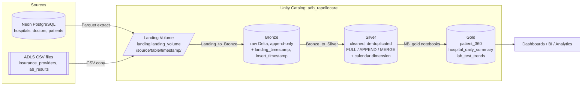

# RapolloCare Healthcare Lakehouse (Azure Databricks)

An end-to-end **ELT pipeline on Azure Databricks** that consolidates hospital, doctor, patient, insurance and lab-test data from multiple source systems into a governed **Medallion Lakehouse (Landing -> Bronze -> Silver -> Gold)** on **Unity Catalog** and **Delta Lake**, producing analytics-ready Gold tables for patient, hospital-operations and clinical-quality reporting.

---

## Table of Contents

1. [Business Problem](#business-problem)
2. [Solution Overview](#solution-overview)
3. [Architecture](#architecture)
4. [Data Sources](#data-sources)
5. [Medallion Layers](#medallion-layers)
6. [Gold Data Products](#gold-data-products)
7. [Tech Stack and Skills](#tech-stack-and-skills)
8. [Key Engineering Features](#key-engineering-features)
9. [Repository Structure](#repository-structure)
10. [How to Run](#how-to-run)
11. [Business Problems and Solutions](#business-problems-and-solutions)
12. [Future Enhancements](#future-enhancements)

---

## Business Problem

RapolloCare is a multi-hospital healthcare network. Its operational data is spread across separate systems:

* Master data (hospitals, doctors, patients) lives in an operational **PostgreSQL** database.
* Partner and diagnostic data (insurance providers, lab results) arrives as **CSV files** in cloud storage.

This fragmentation caused:

* No single, trusted view of a patient across hospitals, insurers and lab tests.
* Duplicate and out-of-date master records because the same entity is re-sent on every extract.
* Slow, manual reporting on hospital workload and lab-test outcomes.
* No easy way to spot rising abnormal or critical test rates over time.
* No lineage or audit trail showing when a record arrived or was last changed.

## Solution Overview

A metadata-driven, parameterised Databricks ELT framework that:

* **Extracts** data from PostgreSQL and CSV files into a Unity Catalog **landing volume**, partitioned by source system, table and load timestamp.
* **Loads** each batch as-is into **Bronze** Delta tables with audit columns (raw history).
* **Transforms** Bronze into clean, de-duplicated **Silver** tables using configurable `FULL`, `APPEND` or `MERGE` (upsert) loads.
* **Models** business-ready **Gold** tables (Patient 360, Hospital Daily Summary, Lab Test Trends) driven by a Source-to-Target Mapping (STTM) document.
* Uses one reusable notebook per layer, parameterised with widgets, so new tables are onboarded by configuration instead of new code.

---

## Architecture



Text version:

```
 Neon PostgreSQL (Parquet) --+
                             +--> Landing Volume --> Bronze --> Silver --> Gold --> BI / Analytics
 ADLS CSV files -------------+   (UC Volume)        (raw)      (clean)    (business)
```

**Design principles**

* **Medallion architecture** separating raw, cleansed and business-level data.
* **Unity Catalog** catalog `adb_rapollocare` with schemas `landing`, `bronze`, `silver`, `gold` for governance and lineage.
* **Delta Lake** for ACID writes, MERGE upserts and time travel.
* **Parameter-driven notebooks** so a single notebook serves every table in a layer.
* **Batch isolation** by `landing_timestamp`: each run processes exactly one landed batch, which makes runs idempotent and easy to re-run.

---

## Data Sources

| Source system | Landing folder | Format | Entities | Description |
| --- | --- | --- | --- | --- |
| Neon PostgreSQL (operational DB) | `neon_postgres/` | Parquet | `hospitals`, `doctors`, `patients` | Master data: hospital network, doctors and registered patients |
| Azure Data Lake Storage (file drops) | `adls_csv/` | CSV (header) | `insurance_providers`, `lab_results` | Insurance partner reference data and lab test results |
| Generated in Databricks | n/a | Delta | `calendar` | Date dimension 1940-01-01 to 2030-12-31 (key `date_key` = yyyyMMdd) |

Landing path convention:

```
/Volumes/adb_rapollocare/landing/landing_volume/<source_system>/<table_name>/<landing_timestamp>/
   e.g. /neon_postgres/patients/2026-10-30_12:27:54/
        /adls_csv/lab_results/2026-11-10_10:49:45/
```

Current data volumes:

| Entity | Bronze rows (all batches) | Silver rows (current) |
| --- | --- | --- |
| hospitals | 354 | 51 |
| doctors | 3,508 | 502 |
| patients | 15,005 | 5,003 |
| insurance_providers | 235 | 30 |
| lab_results | 8,248 | 8,248 |

Bronze keeps every landed batch; Silver keeps one current record per business key, which shows the de-duplication done by the MERGE load.

---

## Medallion Layers

### Landing (Unity Catalog Volume)
* Raw files exactly as extracted, organised by source system, table and load timestamp.

### Bronze: `Landing_to_Bronze` notebook
* Parameters: `source_system`, `table_name`, `landing_timestamp`, `source_file_format`.
* Builds the landing path and **exits gracefully** if no new files arrived for that batch.
* Reads CSV (header, schema inference) or Parquet based on `source_file_format`.
* Adds audit columns `landing_timestamp` and `insert_timestamp`.
* **Appends** to `adb_rapollocare.bronze.<table_name>`, keeping a full raw history.

### Silver: `Bronze_to_Silver` notebook
* Parameters: `landing_timestamp`, `table_name`, `merge_keys`, `load_type`.
* Reads only the Bronze rows for the given `landing_timestamp` batch.
* Adds audit columns `insert_timestamp` and `update_timestamp`.
* Writes to `adb_rapollocare.silver.<table_name>` using a configurable strategy:

| load_type | Behaviour | Typical use |
| --- | --- | --- |
| `FULL` | Overwrite the target with the current batch | Small reference tables re-sent in full |
| `APPEND` | Insert the batch as-is | Transactional/event data such as lab results |
| `MERGE` | Delta MERGE upsert on `merge_keys` (comma-separated); de-duplicates the batch on the keys, keeps the original `insert_timestamp`, refreshes `update_timestamp`; creates the table on first run | Master data such as hospitals, doctors, patients |

* Validates that merge keys exist, prints the equivalent SQL for traceability, and logs rows inserted/updated from the Delta history.
* Returns the processed record count via `dbutils.notebook.exit` for the calling orchestrator.

### Calendar dimension: `Calendar Dimension` notebook
* Builds `adb_rapollocare.silver.calendar` with day, week, month, quarter, year, weekend flags and fiscal attributes, used by Gold for time-based reporting.

### Gold: `Gold/NB_<gold_table>` notebooks
* Designed from the Source-to-Target Mapping `Gold/sttm_silver_to_gold.xlsx`.
* Naming convention `NB_<gold_table>`; FULL rebuild with `CREATE OR REPLACE TABLE ... AS SELECT`; LEFT JOIN from the driving table so no records are lost.
* Each notebook returns its record count to the orchestrator.

---

## Gold Data Products

| Gold table | Grain | Built from | Key metrics |
| --- | --- | --- | --- |
| `gold.patient_360` | One row per patient (5,003) | patients, hospitals, insurance_providers, lab_results | Age, registered hospital, insurer, total / abnormal / critical tests, last test date |
| `gold.hospital_daily_summary` | One row per hospital per day (6,711) | lab_results, hospitals, calendar | Total tests, unique patients, active doctors, abnormal % and critical %, day-over-day test volume change (LAG) |
| `gold.lab_test_trends` | One row per test type per month (78) | lab_results, calendar | Monthly test volumes, abnormal % and critical %, month-over-month abnormal-rate change (LAG) |

---

## Tech Stack and Skills

| Category | Tools / Skills |
| --- | --- |
| Cloud and platform | Microsoft Azure, Azure Databricks |
| Storage and format | ADLS Gen2, Unity Catalog Volumes, Delta Lake, Parquet, CSV |
| Source database | Neon PostgreSQL |
| Governance | Unity Catalog (catalog / schema / volume, managed tables, lineage) |
| Processing | Apache Spark, PySpark DataFrame API, Spark SQL |
| Load patterns | Full load, incremental append, Delta MERGE (upsert / SCD Type 1), batch-based idempotent loads |
| Data modelling | Medallion architecture, dimensional modelling (calendar dimension), aggregate fact tables, Source-to-Target Mapping (STTM) |
| SQL techniques | CTEs, window functions (LAG), conditional aggregation (`count_if`), CTAS, date handling |
| Engineering practices | Parameterised notebooks (widgets), metadata-driven design, audit columns, logging, input validation, graceful exits, record-count return values |
| Orchestration | Databricks notebooks called by an orchestrator via parameters (`dbutils.notebook.exit` returns counts) |
| Version control | Git, GitHub, Databricks Git folders |

---

## Key Engineering Features

* **Reusable, parameterised framework**: two generic notebooks handle every Bronze and Silver table; new tables are added by passing new parameters.
* **Multiple source formats**: CSV and Parquet handled by the same ingestion notebook.
* **Three load strategies**: FULL, APPEND and MERGE, selected per table at runtime.
* **Safe upserts**: source de-duplication on merge keys prevents multiple-match MERGE errors; `insert_timestamp` is preserved on update.
* **Auditability**: `landing_timestamp`, `insert_timestamp` and `update_timestamp` on every record, plus Delta history metrics (rows inserted / updated).
* **Idempotent batches**: each run is scoped to one `landing_timestamp`, so a failed batch can be re-run safely.
* **Graceful no-data handling**: the Bronze notebook exits cleanly when no new files exist.
* **Documentation-driven Gold**: Gold logic is traceable to the STTM workbook.

---

## Repository Structure

```
rapollocare-adb-repo/
|-- Landing_to_Bronze          # Landing volume -> Bronze (CSV / Parquet, append + audit columns)
|-- Bronze_to_Silver           # Bronze -> Silver (FULL / APPEND / MERGE)
|-- Calendar Dimension         # Builds silver.calendar
|-- Gold/
|   |-- sttm_silver_to_gold.xlsx    # Source-to-Target Mapping for Gold
|   |-- NB_patient_360              # gold.patient_360
|   |-- NB_hospital_daily_summary   # gold.hospital_daily_summary
|   |-- NB_lab_test_trends          # gold.lab_test_trends
|-- README.md
```

---

## How to Run

1. Land source extracts into `/Volumes/adb_rapollocare/landing/landing_volume/<source_system>/<table_name>/<landing_timestamp>/`.
2. Run `Landing_to_Bronze` with, for example:
   `source_system=neon_postgres`, `table_name=patients`, `landing_timestamp=2026-10-30_12:27:54`, `source_file_format=parquet`
3. Run `Bronze_to_Silver` with, for example:
   `table_name=patients`, `landing_timestamp=2026-10-30_12:27:54`, `load_type=MERGE`, `merge_keys=patient_id`
4. Run `Calendar Dimension` once (or when the date range must be extended).
5. Run the Gold notebooks: `NB_patient_360`, `NB_hospital_daily_summary`, `NB_lab_test_trends`.

---

## Business Problems and Solutions

| # | Business problem | Solution in this project | Outcome |
| --- | --- | --- | --- |
| 1 | Data siloed across PostgreSQL and CSV file drops | Single landing volume and medallion lakehouse in one Unity Catalog catalog | One governed source of truth for all healthcare data |
| 2 | Master records re-sent on every extract, creating duplicates (e.g. 15,005 patient rows landed for 5,003 patients) | Delta MERGE upsert on business keys with in-batch de-duplication | Exactly one current record per patient, doctor, hospital and insurer |
| 3 | No history or audit trail of changes | Append-only Bronze plus `landing_timestamp`, `insert_timestamp`, `update_timestamp` and Delta time travel | Full traceability of when data arrived and changed |
| 4 | No unified patient view for care coordination and billing | `gold.patient_360` combining demographics, hospital, insurer and lab summary | Patient 360 profile ready for care teams and insurance analysis |
| 5 | Limited visibility into hospital workload and quality | `gold.hospital_daily_summary` with tests, unique patients, active doctors, abnormal / critical rates and day-over-day change | Daily operational monitoring and staffing / capacity planning |
| 6 | Hard to detect rising abnormal or critical test results | `gold.lab_test_trends` with monthly rates and month-over-month change | Early warning on clinical-quality and population-health trends |
| 7 | Inconsistent date reporting (weekends, months, quarters, fiscal year) | Shared `silver.calendar` dimension | Consistent time-based reporting across all Gold tables |
| 8 | High effort to onboard new tables or sources | Parameterised, metadata-driven notebooks with configurable load types | New tables added by configuration, not new code |
| 9 | Failed or empty loads breaking downstream jobs | Batch-scoped idempotent runs, graceful exit on no data, key validation and record-count outputs | Reliable, re-runnable pipeline that is easy to monitor |

---

## Future Enhancements

* Data quality checks (null, range and referential-integrity rules) with quarantine tables.
* SCD Type 2 history for patients and doctors.
* Incremental Gold refreshes instead of FULL rebuilds.
* Orchestrate end-to-end with Lakeflow Jobs and deploy with Declarative Automation Bundles (CI/CD).
* AI/BI dashboards on top of the Gold layer.
